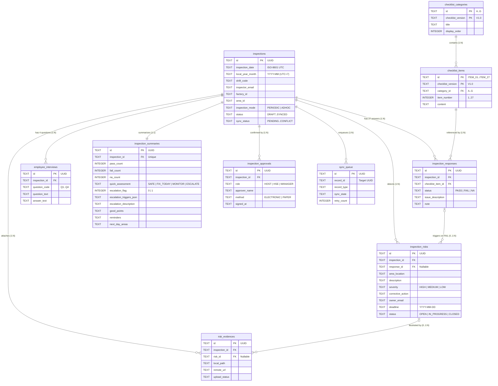

# TÀI LIỆU ĐẶC TẢ THIẾT KẾ CƠ SỞ DỮ LIỆU (DATABASE DESIGN SPECIFICATION)

| Thông tin | Chi tiết |
| :--- | :--- |
| **Tên dự án** | ADC Daily HSE Inspection |
| **Mã dự án** | ADC-HSE-APP-001 |
| **Mã tài liệu** | DDS-APP-001 (Trích xuất & Mở rộng từ Chương 08 - SDS-APP-001) |
| **Phiên bản** | 1.1 |
| **Ngày cập nhật** | 06/11/2026 |
| **Biểu mẫu gốc** | ADC_IFR_EH_QC_01_PL07 \| V1.0 |
| **Kiến trúc lưu trữ** | **Local:** Room / SQLite (Offline-first)<br>**Remote Data:** SharePoint Online Excel Workbook (`HSE_Inspections_<YYYY>.xlsx`)<br>**Remote Media:** SharePoint Document Library (`HSE_Evidence`) |

---

## 1. TỔNG QUAN KIẾN TRÚC DỮ LIỆU

Hệ thống sử dụng mô hình **Offline-First** trên nền tảng Android:
1. **Local Operational Store (SQLite / Room):** Lưu trữ toàn bộ dữ liệu cấu hình, danh mục, phiếu kiểm tra đang thực hiện và lịch sử trên thiết bị. Mọi thao tác đọc/ghi từ UI đều diễn ra trực tiếp với Room thông qua Coroutines/Flow để đảm bảo tốc độ tức thời không phụ thuộc mạng.
2. **Local File Storage (App-specific Sandbox):** Lưu trữ các file ảnh chụp hiện trường hoặc chọn từ thư viện trước và sau khi nén. SQLite chỉ lưu đường dẫn (`local_path`), kích thước, checksum SHA-256 và trạng thái tải lên.
3. **Remote Shared Store (Microsoft 365 / SharePoint):**
   * **Dữ liệu bản ghi (Structured Records):** Đồng bộ qua Microsoft Graph (Excel Workbook API) vào một file Excel dùng chung toàn công ty cho mỗi năm: `HSE_Inspections_<YYYY>.xlsx`. Mỗi tháng là một worksheet tên `YYYY-MM` chứa một Excel Table tên `tbl_YYYY_MM`.
   * **Dữ liệu phẳng hóa (Single-Table Design trên Excel):** Do Excel không phải là hệ quản trị CSDL quan hệ (RDBMS), toàn bộ các bảng nghiệp vụ từ SQLite khi đồng bộ lên Excel sẽ được ánh xạ thành các dòng (rows) chung cấu trúc cột, phân biệt bởi cột `RecordType` và liên kết với nhau qua khóa `InspectionId` / `ParentRecordId` (UUID).
   * **Dữ liệu hình ảnh (Binary Evidence):** Tải lên SharePoint Document Library `HSE_Evidence`, đường dẫn chia sẻ nội bộ được ghi ngược vào cột `EvidenceUrl` trên dòng Excel tương ứng.

---

## 2. SƠ ĐỒ QUAN HỆ THỰC THỂ (ERD - LOCAL SQLITE)



---

## 3. TỪ ĐIỂN DỮ LIỆU CHI TIẾT (LOCAL DATABASE - ROOM / SQLITE)

### 3.1. Nhóm bảng Danh mục & Cấu hình (Master & Reference Tables)

#### Bảng 1: `checklist_categories` (Nhóm hạng mục kiểm tra A – G)
Lưu trữ 7 nhóm hạng mục kiểm tra theo Mục 2.A của biểu mẫu PL07.

| Tên cột | Kiểu dữ liệu | Ràng buộc | Nullable | Mặc định | Mô tả nghiệp vụ |
| :--- | :--- | :--- | :---: | :--- | :--- |
| `id` | `TEXT` | PK (Composite) | No | - | Mã nhóm: `'A'`, `'B'`, `'C'`, `'D'`, `'E'`, `'F'`, `'G'` |
| `checklist_version` | `TEXT` | PK (Composite) | No | `'V1.0'` | Phiên bản biểu mẫu (theo dõi lịch sử thay đổi) |
| `title` | `TEXT` | NOT NULL | No | - | Tên nhóm (VD: `'TÁC PHONG – PPE – HÀNH VI AN TOÀN'`) |
| `display_order` | `INTEGER` | NOT NULL | No | - | Thứ tự hiển thị trên UI (1 đến 7) |
| `is_active` | `INTEGER` | CHECK (0,1) | No | `1` | Trạng thái kích hoạt (`1`: Active, `0`: Inactive) |

#### Bảng 2: `checklist_items` (27 Hạng mục kiểm tra chi tiết)
Lưu trữ 27 câu hỏi quan sát hiện trường thuộc 7 nhóm A–G.

| Tên cột | Kiểu dữ liệu | Ràng buộc | Nullable | Mặc định | Mô tả nghiệp vụ |
| :--- | :--- | :--- | :---: | :--- | :--- |
| `id` | `TEXT` | PK (Composite) | No | - | Mã hạng mục ổn định: `'ITEM_01'` đến `'ITEM_27'` |
| `checklist_version` | `TEXT` | PK (Composite) | No | `'V1.0'` | Phiên bản checklist (`'V1.0'`) |
| `category_id` | `TEXT` | FK | No | - | Tham chiếu `checklist_categories.id` (`'A'`..`'G'`) |
| `item_number` | `INTEGER` | NOT NULL | No | - | Số thứ tự hiển thị theo biểu mẫu (`1` đến `27`) |
| `content` | `TEXT` | NOT NULL | No | - | Nội dung hạng mục kiểm tra |
| `is_active` | `INTEGER` | CHECK (0,1) | No | `1` | Trạng thái sử dụng (`1`: Active, `0`: Deprecated) |

#### Bảng 3: `reference_catalogs` (Danh mục Nhà máy, Khu vực, Ca làm việc, Đơn vị)
Bảng danh mục dùng chung để tránh nhập tự do sai lệch khi lọc báo cáo.

| Tên cột | Kiểu dữ liệu | Ràng buộc | Nullable | Mặc định | Mô tả nghiệp vụ |
| :--- | :--- | :--- | :---: | :--- | :--- |
| `catalog_type` | `TEXT` | PK (Composite) | No | - | Loại danh mục: `'FACTORY'`, `'AREA'`, `'SHIFT'`, `'UNIT'` |
| `code` | `TEXT` | PK (Composite) | No | - | Mã định danh (VD: `'FAC_01'`, `'AREA_PACKING'`, `'SHIFT_1'`) |
| `name` | `TEXT` | NOT NULL | No | - | Tên hiển thị tiếng Việt |
| `parent_code` | `TEXT` | INDEX | Yes | `NULL` | Mã cấp cha (VD: `AREA` thuộc `FACTORY` nào) |
| `display_order` | `INTEGER` | NOT NULL | No | `0` | Thứ tự sắp xếp |
| `is_active` | `INTEGER` | CHECK (0,1) | No | `1` | Còn hiệu lực hay không |
| `updated_at` | `TEXT` | NOT NULL | No | - | Thời điểm đồng bộ danh mục gần nhất (ISO-8601) |

---

### 3.2. Nhóm bảng Nghiệp vụ chính (Operational Tables)

#### Bảng 4: `inspections` (Thông tin chung Phiếu kiểm tra - Mục 1 Biểu mẫu)
Lưu thông tin Header của mỗi lần đi kiểm tra hiện trường.

| Tên cột | Kiểu dữ liệu | Ràng buộc | Nullable | Mặc định | Mô tả nghiệp vụ |
| :--- | :--- | :--- | :---: | :--- | :--- |
| `id` | `TEXT` | PK | No | UUID v4 | Mã định danh duy nhất toàn cục (`InspectionId`) |
| `document_code` | `TEXT` | NOT NULL | No | `'ADC_IFR_EH_QC_01_PL07'` | Mã tài liệu theo chuẩn ISO công ty |
| `checklist_version` | `TEXT` | NOT NULL | No | `'V1.0'` | Phiên bản bộ câu hỏi áp dụng lúc tạo phiếu |
| `inspection_date` | `TEXT` | INDEX | No | - | Thời gian thực hiện (ISO-8601 UTC, VD: `2026-11-06T01:30:00Z`) |
| `local_date` | `TEXT` | INDEX | No | - | Ngày kiểm tra theo giờ VN `UTC+7` (`YYYY-MM-DD`) |
| `local_year_month` | `TEXT` | INDEX | No | - | Tháng kiểm tra theo giờ VN (`YYYY-MM`) dùng định tuyến Sheet Excel |
| `shift_time` | `TEXT` | NOT NULL | No | - | Ca / giờ kiểm tra (VD: `'Ca 1 (06:00 - 14:00)'`) |
| `inspector_id` | `TEXT` | NOT NULL | No | - | Object ID từ Microsoft Entra ID của người thực hiện |
| `inspector_email` | `TEXT` | INDEX | No | - | Email Microsoft 365 của người thực hiện |
| `inspector_name` | `TEXT` | NOT NULL | No | - | Họ tên người thực hiện |
| `executing_unit` | `TEXT` | NOT NULL | No | `'Bộ phận HSE'` | Đơn vị thực hiện |
| `cooperating_personnel`| `TEXT` | - | Yes | `NULL` | Người/đơn vị phối hợp thực hiện |
| `factory_id` | `TEXT` | INDEX | No | - | Mã nhà máy kiểm tra |
| `factory_name` | `TEXT` | NOT NULL | No | - | Tên nhà máy kiểm tra |
| `area_id` | `TEXT` | INDEX | No | - | Mã khu vực kiểm tra |
| `area_name` | `TEXT` | NOT NULL | No | - | Tên khu vực kiểm tra |
| `inspection_mode` | `TEXT` | CHECK | No | `'PERIODIC'` | Hình thức: `'PERIODIC'` (Định kỳ) \| `'ADHOC'` (Đột xuất) |
| `weather_special_note` | `TEXT` | - | Yes | `NULL` | Điều kiện thời tiết / ghi chú đặc biệt |
| `status` | `TEXT` | INDEX, CHECK| No | `'DRAFT'` | `'DRAFT'`, `'IN_PROGRESS'`, `'COMPLETED_LOCAL'`, `'LOCKED'` |
| `sync_status` | `TEXT` | INDEX, CHECK| No | `'PENDING'` | `'LOCAL_ONLY'`, `'PENDING'`, `'SYNCING'`, `'SYNCED'`, `'FAILED'`, `'CONFLICT'` |
| `sync_version` | `INTEGER` | NOT NULL | No | `1` | Số phiên bản tăng dần mỗi lần cập nhật để kiểm soát Conflict |
| `remote_file_id` | `TEXT` | - | Yes | `NULL` | DriveItem ID của file Excel năm trên SharePoint |
| `remote_sheet_name` | `TEXT` | - | Yes | `NULL` | Tên sheet đã ghi (VD: `'2026-11'`) |
| `created_at` | `TEXT` | NOT NULL | No | - | Thời điểm khởi tạo phiếu (ISO-8601 UTC) |
| `updated_at` | `TEXT` | NOT NULL | No | - | Thời điểm chỉnh sửa cuối cùng (ISO-8601 UTC) |
| `completed_at` | `TEXT` | - | Yes | `NULL` | Thời điểm bấm Hoàn tất phiếu (ISO-8601 UTC) |
| `synced_at` | `TEXT` | - | Yes | `NULL` | Thời điểm đồng bộ thành công gần nhất |
| `is_deleted` | `INTEGER` | CHECK (0,1) | No | `0` | Cờ xóa mềm (`0`: Bình thường, `1`: Đã xóa nháp) |

#### Bảng 5: `inspection_responses` (Kết quả 27 hạng mục quan sát - Mục 2.A Biểu mẫu)
Lưu trạng thái đánh giá của từng hạng mục trong một phiếu.

| Tên cột | Kiểu dữ liệu | Ràng buộc | Nullable | Mặc định | Mô tả nghiệp vụ |
| :--- | :--- | :--- | :---: | :--- | :--- |
| `id` | `TEXT` | PK | No | UUID v4 | Mã bản ghi câu trả lời (`RecordId` trên Excel) |
| `inspection_id` | `TEXT` | FK, INDEX | No | - | Tham chiếu `inspections.id` |
| `checklist_item_id` | `TEXT` | FK | No | - | Tham chiếu `checklist_items.id` (`'ITEM_01'`..`'ITEM_27'`) |
| `category_id` | `TEXT` | NOT NULL | No | - | Nhóm `'A'`..`'G'` (Denormalized để truy vấn nhanh) |
| `item_number` | `INTEGER` | NOT NULL | No | - | Số thứ tự `1`..`27` |
| `status` | `TEXT` | CHECK | No | - | `'PASS'` (Đạt), `'FAIL'` (Không đạt), `'NA'` (Không áp dụng) |
| `issue_description` | `TEXT` | - | Yes | `NULL` | Mô tả lỗi (Bắt buộc khác NULL/rỗng ở tầng Domain nếu `status = 'FAIL'`) |
| `note` | `TEXT` | - | Yes | `NULL` | Ghi chú bổ sung cho hạng mục |
| `sync_version` | `INTEGER` | NOT NULL | No | `1` | Phiên bản đồng bộ của dòng |
| `updated_at` | `TEXT` | NOT NULL | No | - | Thời gian cập nhật câu trả lời |
| `updated_by` | `TEXT` | NOT NULL | No | - | Email người cập nhật |

* **Ràng buộc Unique:** `UNIQUE(inspection_id, checklist_item_id)` đảm bảo mỗi phiếu chỉ có tối đa 1 kết quả hiện hành cho mỗi hạng mục.

#### Bảng 6: `employee_interviews` (Trao đổi với người lao động - Mục 2.B Biểu mẫu)
Lưu nội dung 4 câu hỏi phỏng vấn người lao động tại hiện trường.

| Tên cột | Kiểu dữ liệu | Ràng buộc | Nullable | Mặc định | Mô tả nghiệp vụ |
| :--- | :--- | :--- | :---: | :--- | :--- |
| `id` | `TEXT` | PK | No | UUID v4 | Mã định danh câu trả lời phỏng vấn (`RecordId`) |
| `inspection_id` | `TEXT` | FK, INDEX | No | - | Tham chiếu `inspections.id` |
| `question_code` | `TEXT` | CHECK | No | - | Mã câu hỏi: `'Q1'`, `'Q2'`, `'Q3'`, `'Q4'` |
| `question_number` | `INTEGER` | CHECK (1..4)| No | - | Số thứ tự câu hỏi (`1`..`4`) |
| `question_text` | `TEXT` | NOT NULL | No | - | Nội dung câu hỏi (Cố định với Q1-Q3, cho phép nhập rõ câu hỏi với Q4) |
| `answer_text` | `TEXT` | - | Yes | `NULL` | Nội dung trả lời / ghi nhận từ người lao động |
| `interviewee_note` | `TEXT` | - | Yes | `NULL` | Vị trí / bộ phận của NLĐ được hỏi (không bắt buộc định danh cá nhân) |
| `sync_version` | `INTEGER` | NOT NULL | No | `1` | Phiên bản đồng bộ |
| `updated_at` | `TEXT` | NOT NULL | No | - | Thời điểm ghi nhận |

* **Ràng buộc Unique:** `UNIQUE(inspection_id, question_code)`.

#### Bảng 7: `inspection_summaries` (Kết quả kiểm tra, Escalation & Nhận xét cuối ngày - Mục 3, 5, 6 Biểu mẫu)
Quan hệ 1-1 với bảng `inspections`, lưu trữ kết quả đếm, đánh giá nhanh, trạng thái Escalation và bài học kinh nghiệm cuối ngày.

| Tên cột | Kiểu dữ liệu | Ràng buộc | Nullable | Mặc định | Mô tả nghiệp vụ |
| :--- | :--- | :--- | :---: | :--- | :--- |
| `id` | `TEXT` | PK | No | UUID v4 | Mã bản ghi tổng kết (`RecordId`) |
| `inspection_id` | `TEXT` | FK, UNIQUE | No | - | Tham chiếu 1-1 với `inspections.id` |
| `pass_count` | `INTEGER` | NOT NULL | No | `0` | Tổng số hạng mục Đạt (`PASS`) |
| `fail_count` | `INTEGER` | NOT NULL | No | `0` | Tổng số hạng mục Không đạt (`FAIL`) |
| `na_count` | `INTEGER` | NOT NULL | No | `0` | Tổng số hạng mục Không áp dụng (`NA`) |
| `unanswered_count` | `INTEGER` | NOT NULL | No | `27` | Số hạng mục chưa đánh dấu (`27 - (pass + fail + na)`) |
| `quick_assessment` | `TEXT` | CHECK | Yes | `NULL` | Đánh giá nhanh (4 mức theo biểu mẫu):<br>• `'SAFE'`: Khu vực an toàn / chấp nhận được<br>• `'FIX_TODAY'`: Có điểm cần khắc phục trong ngày<br>• `'MONITOR'`: Có rủi ro đáng kể cần theo dõi sát<br>• `'ESCALATE'`: Có rủi ro nghiêm trọng cần escalate ngay |
| `escalation_flag` | `INTEGER` | CHECK (0,1) | No | `0` | Có escalate hôm nay không? (`0`: Không, `1`: Có) |
| `escalation_triggers_json`| `TEXT` | - | Yes | `'[]'` | Mảng JSON lưu các mã điều kiện bắt buộc Escalation (Mục 5):<br>• `'SEVERE_ACCIDENT_RISK'` (Nguy cơ tai nạn nghiêm trọng)<br>• `'UNSAFE_EQUIPMENT'` (Thiết bị/máy móc mất an toàn rõ ràng)<br>• `'FIRE_LEAK_HAZARD'` (Rò rỉ/cháy/khói/tia lửa/nguy cơ cháy nổ)<br>• `'BLOCKED_EXIT'` (Lối thoát hiểm bị chặn)<br>• `'MASS_VIOLATION'` (Nhiều người cùng vi phạm an toàn nghiêm trọng)<br>• `'REPEATED_UNFIXED_ISSUE'` (Lỗi lặp lại nhiều lần nhưng không khắc phục) |
| `escalation_description`| `TEXT` | - | Yes | `NULL` | Mô tả ngắn nội dung Escalation (Bắt buộc nếu `escalation_flag = 1`) |
| `good_points` | `TEXT` | - | Yes | `NULL` | Mục 6 - Điểm tốt |
| `reminders` | `TEXT` | - | Yes | `NULL` | Mục 6 - Điểm cần nhắc lại |
| `next_day_areas` | `TEXT` | - | Yes | `NULL` | Mục 6 - Khu vực cần kiểm tra lại ngày mai |
| `sync_version` | `INTEGER` | NOT NULL | No | `1` | Phiên bản đồng bộ |
| `updated_at` | `TEXT` | NOT NULL | No | - | Thời điểm cập nhật |

#### Bảng 8: `inspection_risks` (Danh sách các điểm không đạt / Rủi ro phát hiện - Mục 4 Biểu mẫu)
Lưu chi tiết các điểm không đạt cần theo dõi khắc phục (CAPA/Action tracking).

| Tên cột | Kiểu dữ liệu | Ràng buộc | Nullable | Mặc định | Mô tả nghiệp vụ |
| :--- | :--- | :--- | :---: | :--- | :--- |
| `id` | `TEXT` | PK | No | UUID v4 | Mã định danh rủi ro (`RecordId` / `RiskId`) |
| `inspection_id` | `TEXT` | FK, INDEX | No | - | Tham chiếu `inspections.id` |
| `response_id` | `TEXT` | FK, INDEX | Yes | `NULL` | Tham chiếu `inspection_responses.id` (nếu sinh ra từ một câu `FAIL` cụ thể) |
| `checklist_item_code` | `TEXT` | - | Yes | `NULL` | Mã hạng mục liên quan (`'ITEM_01'`..`'ITEM_27'`) |
| `risk_Order` | `INTEGER` | NOT NULL | No | `1` | STT hiển thị trong bảng Mục 4 |
| `area_location` | `TEXT` | NOT NULL | No | - | Khu vực / vị trí cụ thể phát hiện rủi ro |
| `description` | `TEXT` | NOT NULL | No | - | Mô tả điểm không đạt / rủi ro |
| `severity` | `TEXT` | INDEX, CHECK| No | - | Mức độ rủi ro:<br>• `'HIGH'` (Cao: xử lý ngay)<br>• `'MEDIUM'` (Trung bình: xử lý trong ngày / 1–3 ngày)<br>• `'LOW'` (Thấp: theo kế hoạch) |
| `corrective_action` | `TEXT` | NOT NULL | No | - | Hành động yêu cầu khắc phục |
| `owner_id` | `TEXT` | - | Yes | `NULL` | User ID người chịu trách nhiệm |
| `owner_name` | `TEXT` | NOT NULL | No | - | Họ tên / bộ phận chịu trách nhiệm |
| `owner_email` | `TEXT` | INDEX | Yes | `NULL` | Email người chịu trách nhiệm (dùng để lọc báo cáo) |
| `deadline` | `TEXT` | INDEX | No | - | Thời hạn hoàn thành (`YYYY-MM-DD`) |
| `status` | `TEXT` | INDEX, CHECK| No | `'OPEN'` | Trạng thái: `'OPEN'` (Mở), `'IN_PROGRESS'` (Đang xử lý - mở rộng UI), `'CLOSED'` (Đóng) |
| `closed_at` | `TEXT` | - | Yes | `NULL` | Thời điểm đóng điểm không đạt (ISO-8601 UTC) |
| `closed_by` | `TEXT` | - | Yes | `NULL` | Email người xác nhận đóng |
| `closure_note` | `TEXT` | - | Yes | `NULL` | Ghi chú kết quả khắc phục |
| `sync_version` | `INTEGER` | NOT NULL | No | `1` | Phiên bản đồng bộ (tăng khi cập nhật trạng thái Mở -> Đóng) |
| `created_at` | `TEXT` | NOT NULL | No | - | Thời điểm tạo |
| `updated_at` | `TEXT` | NOT NULL | No | - | Thời điểm cập nhật gần nhất |

#### Bảng 9: `inspection_approvals` (Xác nhận cuối phiếu - Mục 7 Biểu mẫu)
Lưu thông tin xác nhận của 3 vai trò: Người chủ trì, HSE, Quản lý khu vực (Hỗ trợ cả xác nhận điện tử trên app và chụp ảnh bản ký giấy).

| Tên cột | Kiểu dữ liệu | Ràng buộc | Nullable | Mặc định | Mô tả nghiệp vụ |
| :--- | :--- | :--- | :---: | :--- | :--- |
| `id` | `TEXT` | PK | No | UUID v4 | Mã bản ghi xác nhận (`RecordId`) |
| `inspection_id` | `TEXT` | FK, INDEX | No | - | Tham chiếu `inspections.id` |
| `role` | `TEXT` | CHECK | No | - | Vai trò xác nhận:<br>• `'HOST'` (Người chủ trì)<br>• `'HSE'` (Đại diện HSE)<br>• `'MANAGER'` (Quản lý khu vực / Plant Manager) |
| `approver_id` | `TEXT` | - | Yes | `NULL` | Entra Object ID (nếu ký điện tử bằng tài khoản đang đăng nhập) |
| `approver_email` | `TEXT` | - | Yes | `NULL` | Email người xác nhận |
| `approver_name` | `TEXT` | NOT NULL | No | - | Họ và tên người xác nhận |
| `approval_method` | `TEXT` | CHECK | No | `'ELECTRONIC'`| Phương thức: `'ELECTRONIC'` (Xác nhận điện tử) \| `'PAPER'` (Ký tay bản giấy) |
| `signed_at` | `TEXT` | NOT NULL | No | - | Thời điểm xác nhận (ISO-8601 UTC) |
| `evidence_id` | `TEXT` | FK | Yes | `NULL` | Tham chiếu `risk_evidences.id` nếu đính kèm ảnh chụp tờ phiếu ký tay |
| `comment` | `TEXT` | - | Yes | `NULL` | Ý kiến / ghi chú khi xác nhận |
| `sync_version` | `INTEGER` | NOT NULL | No | `1` | Phiên bản đồng bộ |

* **Ràng buộc Unique:** `UNIQUE(inspection_id, role)` đảm bảo mỗi vai trò có 1 bản ghi xác nhận chính thức trên phiếu.

---

### 3.3. Nhóm bảng Bằng chứng & Đồng bộ nền (Media & Synchronization Tables)

#### Bảng 10: `risk_evidences` (Quản lý file ảnh bằng chứng hiện trường)
Lưu metadata của ảnh chụp từ Camera hoặc chọn từ Photo Picker. File nhị phân lưu tại thư mục nội bộ của ứng dụng và đồng bộ lên SharePoint Library `HSE_Evidence`.

| Tên cột | Kiểu dữ liệu | Ràng buộc | Nullable | Mặc định | Mô tả nghiệp vụ |
| :--- | :--- | :--- | :---: | :--- | :--- |
| `id` | `TEXT` | PK | No | UUID v4 | Mã định danh bằng chứng (`EvidenceId`) |
| `inspection_id` | `TEXT` | FK, INDEX | No | - | Tham chiếu `inspections.id` |
| `risk_id` | `TEXT` | FK, INDEX | Yes | `NULL` | Tham chiếu `inspection_risks.id` (nếu là ảnh của Rủi ro) |
| `response_id` | `TEXT` | FK | Yes | `NULL` | Tham chiếu `inspection_responses.id` (nếu đính kèm trực tiếp ở mục checklist) |
| `evidence_type` | `TEXT` | CHECK | No | `'RISK_PHOTO'`| Loại ảnh: `'RISK_PHOTO'`, `'CHECKLIST_PHOTO'`, `'PAPER_SIGNATURE'`, `'REMEDIATION_PHOTO'` |
| `file_name` | `TEXT` | NOT NULL | No | - | Tên file chuẩn hóa: `<InspectionId>_<EvidenceId>.jpg` |
| `local_path` | `TEXT` | NOT NULL | No | - | Đường dẫn tuyệt đối trong App-specific internal storage |
| `mime_type` | `TEXT` | CHECK | No | `'image/jpeg'`| Định dạng cho phép: `'image/jpeg'`, `'image/png'`, `'image/webp'` |
| `size_bytes` | `INTEGER` | NOT NULL | No | `0` | Dung lượng file sau khi nén/resize (Bytes) |
| `sha256_checksum` | `TEXT` | INDEX | No | - | Mã băm SHA-256 dùng để chống upload trùng và kiểm tra toàn vẹn file |
| `remote_drive_item_id`| `TEXT` | - | Yes | `NULL` | DriveItem ID trên SharePoint Library `HSE_Evidence` sau khi tải lên |
| `remote_url` | `TEXT` | - | Yes | `NULL` | Đường dẫn webUrl đến file ảnh trên SharePoint (Ghi vào cột `EvidenceUrl` của Excel) |
| `upload_status` | `TEXT` | INDEX, CHECK| No | `'PENDING'` | `'CAPTURED_LOCAL'`, `'PENDING'`, `'UPLOADING'`, `'UPLOADED'`, `'FAILED'` |
| `created_at` | `TEXT` | NOT NULL | No | - | Thời điểm chụp/chọn ảnh |
| `uploaded_at` | `TEXT` | - | Yes | `NULL` | Thời điểm tải lên SharePoint thành công |

#### Bảng 11: `sync_queue` (Hàng đợi đồng bộ nền cho WorkManager)
Quản lý trạng thái đồng bộ, thứ tự phụ thuộc, cơ chế thử lại (Retry/Backoff) và chống trùng lặp (Idempotency).

| Tên cột | Kiểu dữ liệu | Ràng buộc | Nullable | Mặc định | Mô tả nghiệp vụ |
| :--- | :--- | :--- | :---: | :--- | :--- |
| `id` | `TEXT` | PK | No | UUID v4 | Mã tác vụ trong hàng đợi |
| `inspection_id` | `TEXT` | FK, INDEX | No | - | Gom nhóm toàn bộ các dòng thuộc cùng một phiếu để gửi Batch |
| `record_id` | `TEXT` | UNIQUE | No | - | Khóa chống trùng (`Idempotency Key`) - chính là PK của bản ghi gốc |
| `record_type` | `TEXT` | CHECK | No | - | `'EVIDENCE_FILE'`, `'INSPECTION'`, `'RESPONSE'`, `'INTERVIEW'`, `'RISK'`, `'SUMMARY'`, `'APPROVAL'` |
| `operation` | `TEXT` | CHECK | No | `'UPSERT'` | Thao tác: `'UPSERT'` (Thêm mới hoặc cập nhật), `'UPLOAD_FILE'` |
| `priority` | `INTEGER` | INDEX | No | `10` | Độ ưu tiên thực thi: `1` (Upload Evidence File) -> `2` (Inspection Header) -> `3` (Child Records) |
| `target_year_file` | `TEXT` | NOT NULL | No | - | Tên file đích: `HSE_Inspections_<YYYY>.xlsx` |
| `target_month_sheet` | `TEXT` | NOT NULL | No | - | Tên sheet đích: `YYYY-MM` |
| `sync_state` | `TEXT` | INDEX, CHECK| No | `'PENDING'` | `'PENDING'`, `'IN_FLIGHT'`, `'SYNCED'`, `'FAILED'`, `'CONFLICT'`, `'BLOCKED'` |
| `retry_count` | `INTEGER` | NOT NULL | No | `0` | Số lần đã thử lại |
| `next_attempt_at` | `INTEGER` | INDEX | No | `0` | Epoch milliseconds cho lần retry tiếp theo (tính theo Exponential Backoff / `Retry-After`) |
| `last_error_code` | `TEXT` | - | Yes | `NULL` | Mã lỗi chuẩn hóa (VD: `'EXCEL_LOCKED'`, `'THROTTLED'`, `'REMOTE_TEMPLATE_MISSING'`) |
| `last_error_message` | `TEXT` | - | Yes | `NULL` | Chi tiết kỹ thuật / Correlation ID từ Microsoft Graph |
| `created_at` | `TEXT` | NOT NULL | No | - | Thời điểm đưa vào hàng đợi |
| `updated_at` | `TEXT` | NOT NULL | No | - | Thời điểm chạy worker gần nhất |

---

## 4. THIẾT KẾ CẤU TRÚC LƯU TRỮ REMOTE (SHAREPOINT EXCEL & DOCUMENT LIBRARY)

Theo **ADR-007 (Baseline V1.1)**, toàn bộ dữ liệu từ ứng dụng được ghi trực tiếp qua **Microsoft Graph Excel Workbook API** vào file Excel dùng chung.

### 4.1. Quy ước Tổ chức File, Sheet và Table trên SharePoint
* **SharePoint Site:** Cấu hình theo biến môi trường (`SHAREPOINT_SITE_ID`).
* **Thư mục chứa file dữ liệu:** Lưu trữ các file Excel theo từng năm với tên chuẩn:
  * Năm 2026: `HSE_Inspections_2026.xlsx`
  * Năm 2027: `HSE_Inspections_2027.xlsx`
* **Quy ước Worksheet (12 sheets / file):** Mỗi tháng là 1 sheet mang tên `YYYY-MM` (Ví dụ: `2026-01`, `2026-02`, ..., `2026-11`, `2026-12`).
* **Quy ước Excel Table:** Trong mỗi sheet `YYYY-MM`, IT khởi tạo sẵn 1 bảng Excel (Table Object) có tên tương ứng (thay dấu `-` bằng `_` theo quy tắc đặt tên Table của Excel): `tbl_2026_01`, ..., `tbl_2026_11`, `tbl_2026_12`.
* **Quy tắc định tuyến thời gian (Time Routing Rule):**
  * File năm và Sheet tháng được xác định dựa trên thời điểm `inspection_date` **đã quy đổi sang múi giờ Việt Nam (`UTC+7`)**, tức cột `local_year_month`.
  * *Ví dụ (Test Case TC-012):* Một phiếu được tạo lúc `23:30 ngày 30/11/2026 (giờ VN)` nhưng mất mạng đến `08:00 ngày 01/12/2026` mới đồng bộ, hệ thống **bắt buộc** ghi vào sheet `2026-11` (Bảng `tbl_2026_11`).

### 4.2. Cấu trúc 24 Cột chuẩn của Excel Table (`tbl_YYYY_MM`)
Mỗi dòng trong bảng Excel đại diện cho một bản ghi logic. Để người dùng bộ phận HSE có thể lọc/tổng hợp trực tiếp bằng bộ lọc (AutoFilter) của Excel mà không cần bóc tách JSON, các trường tìm kiếm phổ biến được tách thành cột riêng:

| Thứ tự cột (0-based) | Tên cột trên Excel Table | Kiểu dữ liệu Excel | Nguồn ánh xạ & Ý nghĩa |
| :---: | :--- | :--- | :--- |
| **0** | `RecordId` | Text (UUID) | **Khóa định danh dòng (Idempotency Key)**. Ánh xạ từ `id` của bảng tương ứng ở SQLite. Duy nhất trên toàn bộ file. |
| **1** | `RecordType` | Text (Enum) | Phân loại bản ghi: `INSPECTION`, `RESPONSE`, `INTERVIEW`, `RISK`, `SUMMARY`, `APPROVAL`. |
| **2** | `InspectionId` | Text (UUID) | Mã phiếu kiểm tra gốc (`inspections.id`). Dùng để gom toàn bộ các dòng của cùng 1 phiếu. |
| **3** | `ParentRecordId` | Text (UUID) | Mã bản ghi cha trực tiếp (VD: Với `RISK` sinh ra từ câu trả lời `FAIL` thì `ParentRecordId = response_id`; các loại khác để bằng `InspectionId`). |
| **4** | `InspectionDate` | Text (`YYYY-MM-DD HH:mm`) | Thời gian kiểm tra theo giờ Việt Nam (`UTC+7`). Giúp HSE lọc theo ngày. |
| **5** | `Factory` | Text | Tên/Mã nhà máy (`factory_name`). Lọc trực tiếp trên Excel. |
| **6** | `Area` | Text | Khu vực kiểm tra (`area_name`) hoặc vị trí cụ thể của rủi ro (`area_location`). |
| **7** | `Shift` | Text | Ca làm việc (`shift_time`). |
| **8** | `InspectorEmail` | Text | Email người thực hiện kiểm tra (`inspector_email`). |
| **9** | `InspectionMode` | Text | Hình thức: `PERIODIC` (Định kỳ) / `ADHOC` (Đột xuất). |
| **10** | `ChecklistItemCode` | Text | Mã hạng mục `ITEM_01`..`ITEM_27` (Chỉ điền đối với dòng `RESPONSE` và `RISK` liên kết, còn lại để trống `""`). |
| **11** | `CategoryCode` | Text | Mã nhóm `A`..`G` (Áp dụng cho dòng `RESPONSE`) hoặc mã câu hỏi `Q1`..`Q4` (cho dòng `INTERVIEW`). |
| **12** | `Status` | Text | • Dòng `INSPECTION`: `COMPLETED`<br>• Dòng `RESPONSE`: `PASS` \| `FAIL` \| `NA`<br>• Dòng `SUMMARY`: Giá trị `quick_assessment` (`SAFE` \| `FIX_TODAY` \| `MONITOR` \| `ESCALATE`)<br>• Dòng `APPROVAL`: `ELECTRONIC` \| `PAPER` |
| **13** | `Severity` | Text | Mức độ rủi ro: `HIGH` \| `MEDIUM` \| `LOW` (Chỉ điền ở dòng `RISK`, hoặc ghi `'ESCALATED'` ở dòng `SUMMARY` nếu `escalation_flag = 1`). |
| **14** | `Description` | Text | Nội dung chính của dòng:<br>• `RESPONSE`: Mô tả lỗi (`issue_description`)<br>• `INTERVIEW`: Nội dung trả lời (`answer_text`)<br>• `RISK`: Mô tả rủi ro (`description`)<br>• `SUMMARY`: Mô tả Escalation / Nhận xét chung |
| **15** | `CorrectiveAction` | Text | Hành động khắc phục yêu cầu (Dòng `RISK`) hoặc Ghi chú (Dòng `RESPONSE` / `APPROVAL`). |
| **16** | `OwnerEmail` | Text | Email hoặc tên người chịu trách nhiệm xử lý (Dòng `RISK`) / Người ký xác nhận (Dòng `APPROVAL`). |
| **17** | `Deadline` | Text (`YYYY-MM-DD`) | Thời hạn xử lý rủi ro (Dòng `RISK`). |
| **18** | `RiskStatus` | Text | Trạng thái đóng/mở rủi ro: `OPEN` \| `IN_PROGRESS` \| `CLOSED` (Dòng `RISK`). |
| **19** | `EvidenceUrl` | Text (URL) | Đường dẫn SharePoint đến ảnh bằng chứng trong thư viện `HSE_Evidence` (Ngăn cách bằng `;` nếu có nhiều ảnh). |
| **20** | `SchemaVersion` | Text | Phiên bản cấu trúc dữ liệu (`"1.1"`). |
| **21** | `SyncVersion` | Number | Số nguyên tăng dần (`1, 2, 3...`) phục vụ kiểm tra xung đột (Optimistic Concurrency Control). |
| **22** | `CreatedAt` | Text (ISO-8601 UTC) | Thời điểm tạo bản ghi dưới thiết bị. |
| **23** | `UpdatedAt` | Text (ISO-8601 UTC) | Thời điểm cập nhật bản ghi lần cuối. |
| **24** | `UpdatedBy` | Text | Email tài khoản Microsoft 365 thực hiện cập nhật/đồng bộ. |
| **25** | `PayloadJson` | Text (JSON) | Chuỗi JSON nén chứa toàn bộ các trường chi tiết theo từng `RecordType` (Đảm bảo độ dài `< 32,767` ký tự của 1 ô Excel). |

### 4.3. Định nghĩa cấu trúc `PayloadJson` theo từng `RecordType`

* **`RecordType = "INSPECTION"` (1 dòng / phiếu):**
  ```json
  {
    "documentCode": "ADC_IFR_EH_QC_01_PL07",
    "checklistVersion": "V1.0",
    "inspectorName": "Nguyễn Văn A",
    "executingUnit": "Bộ phận HSE",
    "cooperatingPersonnel": "Tổ trưởng Bảo trì",
    "weatherSpecialNote": "Trời mưa lớn, độ ẩm khu vực kho cao",
    "completedAt": "2026-11-06T03:15:00Z"
  }
  ```
* **`RecordType = "RESPONSE"` (27 dòng / phiếu):**
  ```json
  {
    "itemNumber": 7,
    "categoryId": "B",
    "status": "FAIL",
    "issueDescription": "Nắp che dây curoa máy đóng gói số 2 bị tháo rời chưa lắp lại",
    "note": "Đã yêu cầu dừng máy tạm thời"
  }
  ```
* **`RecordType = "INTERVIEW"` (4 dòng / phiếu):**
  ```json
  {
    "questionCode": "Q1",
    "questionNumber": 1,
    "questionText": "Bạn biết làm gì khi thấy điều kiện không an toàn?",
    "answerText": "Dừng việc và báo ngay cho Tổ trưởng hoặc nhân viên HSE."
  }
  ```
* **`RecordType = "SUMMARY"` (1 dòng / phiếu):**
  ```json
  {
    "passCount": 24,
    "failCount": 2,
    "naCount": 1,
    "quickAssessment": "FIX_TODAY",
    "escalationFlag": false,
    "escalationTriggers": [],
    "escalationDescription": null,
    "goodPoints": "Công nhân khu vực pha chế tuân thủ 100% đeo kính và khẩu trang.",
    "reminders": "Nhắc nhở bộ phận cơ điện dọn vật tư ngay sau khi bảo trì.",
    "nextDayAreas": "Khu vực máy đóng gói Line 2"
  }
  ```
* **`RecordType = "RISK"` (N dòng / phiếu - tùy số lỗi phát hiện):**
  ```json
  {
    "riskOrder": 1,
    "responseId": "550e8400-e29b-41d4-a716-446655440001",
    "checklistItemCode": "ITEM_07",
    "areaLocation": "Xưởng Sản Xuất 1 - Line 2",
    "description": "Thiếu che chắn bảo vệ bộ truyền động dây curoa",
    "severity": "HIGH",
    "correctiveAction": "Lắp lại nắp che bảo vệ và khóa LOTO trước khi vận hành lại",
    "ownerName": "Trần Văn B (Trưởng bộ phận Bảo trì)",
    "ownerEmail": "b.tran@adc.com.vn",
    "deadline": "2026-11-06",
    "status": "OPEN",
    "evidenceIds": ["770e8400-e29b-41d4-a716-446655440099"]
  }
  ```
* **`RecordType = "APPROVAL"` (3 dòng / phiếu):**
  ```json
  {
    "role": "HOST",
    "approverName": "Nguyễn Văn A",
    "approverEmail": "a.nguyen@adc.com.vn",
    "approvalMethod": "ELECTRONIC",
    "signedAt": "2026-11-06T03:14:20Z",
    "comment": "Xác nhận nội dung kiểm tra hiện trường"
  }
  ```

---

## 5. KỊCH BẢN KHỞI TẠO DATABASE & DỮ LIỆU MẪU (SQLITE DDL & SEED DATA)

Dưới đây là script SQL chuẩn (tương thích hoàn toàn với Room SQLite trên Android) để tạo bảng, chỉ mục và nạp sẵn (Seed) đầy đủ 7 nhóm A–G cùng 27 hạng mục từ file `TemplateHSE.docx`.

```sql
-- ============================================================================
-- 1. TẠO BẢNG DANH MỤC & CẤU HÌNH (MASTER TABLES)
-- ============================================================================

CREATE TABLE IF NOT EXISTS checklist_categories (
    id TEXT NOT NULL,
    checklist_version TEXT NOT NULL DEFAULT 'V1.0',
    title TEXT NOT NULL,
    display_order INTEGER NOT NULL,
    is_active INTEGER NOT NULL DEFAULT 1 CHECK (is_active IN (0, 1)),
    PRIMARY KEY (id, checklist_version)
);

CREATE TABLE IF NOT EXISTS checklist_items (
    id TEXT NOT NULL,
    checklist_version TEXT NOT NULL DEFAULT 'V1.0',
    category_id TEXT NOT NULL,
    item_number INTEGER NOT NULL,
    content TEXT NOT NULL,
    is_active INTEGER NOT NULL DEFAULT 1 CHECK (is_active IN (0, 1)),
    PRIMARY KEY (id, checklist_version),
    FOREIGN KEY (category_id, checklist_version) 
        REFERENCES checklist_categories(id, checklist_version) 
        ON UPDATE CASCADE ON DELETE RESTRICT
);

CREATE TABLE IF NOT EXISTS reference_catalogs (
    catalog_type TEXT NOT NULL CHECK (catalog_type IN ('FACTORY', 'AREA', 'SHIFT', 'UNIT')),
    code TEXT NOT NULL,
    name TEXT NOT NULL,
    parent_code TEXT,
    display_order INTEGER NOT NULL DEFAULT 0,
    is_active INTEGER NOT NULL DEFAULT 1 CHECK (is_active IN (0, 1)),
    updated_at TEXT NOT NULL,
    PRIMARY KEY (catalog_type, code)
);

-- ============================================================================
-- 2. TẠO BẢNG NGHIỆP VỤ KIỂM TRA (OPERATIONAL TABLES)
-- ============================================================================

CREATE TABLE IF NOT EXISTS inspections (
    id TEXT PRIMARY KEY NOT NULL,
    document_code TEXT NOT NULL DEFAULT 'ADC_IFR_EH_QC_01_PL07',
    checklist_version TEXT NOT NULL DEFAULT 'V1.0',
    inspection_date TEXT NOT NULL,
    local_date TEXT NOT NULL,
    local_year_month TEXT NOT NULL,
    shift_time TEXT NOT NULL,
    inspector_id TEXT NOT NULL,
    inspector_email TEXT NOT NULL,
    inspector_name TEXT NOT NULL,
    executing_unit TEXT NOT NULL DEFAULT 'Bộ phận HSE',
    cooperating_personnel TEXT,
    factory_id TEXT NOT NULL,
    factory_name TEXT NOT NULL,
    area_id TEXT NOT NULL,
    area_name TEXT NOT NULL,
    inspection_mode TEXT NOT NULL DEFAULT 'PERIODIC' CHECK (inspection_mode IN ('PERIODIC', 'ADHOC')),
    weather_special_note TEXT,
    status TEXT NOT NULL DEFAULT 'DRAFT' CHECK (status IN ('DRAFT', 'IN_PROGRESS', 'COMPLETED_LOCAL', 'LOCKED')),
    sync_status TEXT NOT NULL DEFAULT 'LOCAL_ONLY' CHECK (sync_status IN ('LOCAL_ONLY', 'PENDING', 'SYNCING', 'SYNCED', 'FAILED', 'CONFLICT')),
    sync_version INTEGER NOT NULL DEFAULT 1,
    remote_file_id TEXT,
    remote_sheet_name TEXT,
    created_at TEXT NOT NULL,
    updated_at TEXT NOT NULL,
    completed_at TEXT,
    synced_at TEXT,
    is_deleted INTEGER NOT NULL DEFAULT 0 CHECK (is_deleted IN (0, 1))
);

CREATE TABLE IF NOT EXISTS inspection_responses (
    id TEXT PRIMARY KEY NOT NULL,
    inspection_id TEXT NOT NULL,
    checklist_item_id TEXT NOT NULL,
    category_id TEXT NOT NULL,
    item_number INTEGER NOT NULL,
    status TEXT NOT NULL CHECK (status IN ('PASS', 'FAIL', 'NA')),
    issue_description TEXT,
    note TEXT,
    sync_version INTEGER NOT NULL DEFAULT 1,
    updated_at TEXT NOT NULL,
    updated_by TEXT NOT NULL,
    FOREIGN KEY (inspection_id) REFERENCES inspections(id) ON DELETE RESTRICT,
    UNIQUE (inspection_id, checklist_item_id)
);

CREATE TABLE IF NOT EXISTS employee_interviews (
    id TEXT PRIMARY KEY NOT NULL,
    inspection_id TEXT NOT NULL,
    question_code TEXT NOT NULL CHECK (question_code IN ('Q1', 'Q2', 'Q3', 'Q4')),
    question_number INTEGER NOT NULL CHECK (question_number BETWEEN 1 AND 4),
    question_text TEXT NOT NULL,
    answer_text TEXT,
    interviewee_note TEXT,
    sync_version INTEGER NOT NULL DEFAULT 1,
    updated_at TEXT NOT NULL,
    FOREIGN KEY (inspection_id) REFERENCES inspections(id) ON DELETE RESTRICT,
    UNIQUE (inspection_id, question_code)
);

CREATE TABLE IF NOT EXISTS inspection_summaries (
    id TEXT PRIMARY KEY NOT NULL,
    inspection_id TEXT NOT NULL UNIQUE,
    pass_count INTEGER NOT NULL DEFAULT 0,
    fail_count INTEGER NOT NULL DEFAULT 0,
    na_count INTEGER NOT NULL DEFAULT 0,
    unanswered_count INTEGER NOT NULL DEFAULT 27,
    quick_assessment TEXT CHECK (quick_assessment IN ('SAFE', 'FIX_TODAY', 'MONITOR', 'ESCALATE')),
    escalation_flag INTEGER NOT NULL DEFAULT 0 CHECK (escalation_flag IN (0, 1)),
    escalation_triggers_json TEXT DEFAULT '[]',
    escalation_description TEXT,
    good_points TEXT,
    reminders TEXT,
    next_day_areas TEXT,
    sync_version INTEGER NOT NULL DEFAULT 1,
    updated_at TEXT NOT NULL,
    FOREIGN KEY (inspection_id) REFERENCES inspections(id) ON DELETE RESTRICT
);

CREATE TABLE IF NOT EXISTS inspection_risks (
    id TEXT PRIMARY KEY NOT NULL,
    inspection_id TEXT NOT NULL,
    response_id TEXT,
    checklist_item_code TEXT,
    risk_order INTEGER NOT NULL DEFAULT 1,
    area_location TEXT NOT NULL,
    description TEXT NOT NULL,
    severity TEXT NOT NULL CHECK (severity IN ('HIGH', 'MEDIUM', 'LOW')),
    corrective_action TEXT NOT NULL,
    owner_id TEXT,
    owner_name TEXT NOT NULL,
    owner_email TEXT,
    deadline TEXT NOT NULL,
    status TEXT NOT NULL DEFAULT 'OPEN' CHECK (status IN ('OPEN', 'IN_PROGRESS', 'CLOSED')),
    closed_at TEXT,
    closed_by TEXT,
    closure_note TEXT,
    sync_version INTEGER NOT NULL DEFAULT 1,
    created_at TEXT NOT NULL,
    updated_at TEXT NOT NULL,
    FOREIGN KEY (inspection_id) REFERENCES inspections(id) ON DELETE RESTRICT,
    FOREIGN KEY (response_id) REFERENCES inspection_responses(id) ON DELETE SET NULL
);

CREATE TABLE IF NOT EXISTS risk_evidences (
    id TEXT PRIMARY KEY NOT NULL,
    inspection_id TEXT NOT NULL,
    risk_id TEXT,
    response_id TEXT,
    evidence_type TEXT NOT NULL DEFAULT 'RISK_PHOTO' CHECK (evidence_type IN ('RISK_PHOTO', 'CHECKLIST_PHOTO', 'PAPER_SIGNATURE', 'REMEDIATION_PHOTO')),
    file_name TEXT NOT NULL,
    local_path TEXT NOT NULL,
    mime_type TEXT NOT NULL DEFAULT 'image/jpeg' CHECK (mime_type IN ('image/jpeg', 'image/png', 'image/webp')),
    size_bytes INTEGER NOT NULL DEFAULT 0,
    sha256_checksum TEXT NOT NULL,
    remote_drive_item_id TEXT,
    remote_url TEXT,
    upload_status TEXT NOT NULL DEFAULT 'CAPTURED_LOCAL' CHECK (upload_status IN ('CAPTURED_LOCAL', 'PENDING', 'UPLOADING', 'UPLOADED', 'FAILED')),
    created_at TEXT NOT NULL,
    uploaded_at TEXT,
    FOREIGN KEY (inspection_id) REFERENCES inspections(id) ON DELETE RESTRICT,
    FOREIGN KEY (risk_id) REFERENCES inspection_risks(id) ON DELETE SET NULL
);

CREATE TABLE IF NOT EXISTS inspection_approvals (
    id TEXT PRIMARY KEY NOT NULL,
    inspection_id TEXT NOT NULL,
    role TEXT NOT NULL CHECK (role IN ('HOST', 'HSE', 'MANAGER')),
    approver_id TEXT,
    approver_email TEXT,
    approver_name TEXT NOT NULL,
    approval_method TEXT NOT NULL DEFAULT 'ELECTRONIC' CHECK (approval_method IN ('ELECTRONIC', 'PAPER')),
    signed_at TEXT NOT NULL,
    evidence_id TEXT,
    comment TEXT,
    sync_version INTEGER NOT NULL DEFAULT 1,
    FOREIGN KEY (inspection_id) REFERENCES inspections(id) ON DELETE RESTRICT,
    FOREIGN KEY (evidence_id) REFERENCES risk_evidences(id) ON DELETE SET NULL,
    UNIQUE (inspection_id, role)
);

CREATE TABLE IF NOT EXISTS sync_queue (
    id TEXT PRIMARY KEY NOT NULL,
    inspection_id TEXT NOT NULL,
    record_id TEXT NOT NULL UNIQUE,
    record_type TEXT NOT NULL CHECK (record_type IN ('EVIDENCE_FILE', 'INSPECTION', 'RESPONSE', 'INTERVIEW', 'RISK', 'SUMMARY', 'APPROVAL')),
    operation TEXT NOT NULL DEFAULT 'UPSERT' CHECK (operation IN ('UPSERT', 'UPLOAD_FILE')),
    priority INTEGER NOT NULL DEFAULT 10,
    target_year_file TEXT NOT NULL,
    target_month_sheet TEXT NOT NULL,
    sync_state TEXT NOT NULL DEFAULT 'PENDING' CHECK (sync_state IN ('PENDING', 'IN_FLIGHT', 'SYNCED', 'FAILED', 'CONFLICT', 'BLOCKED')),
    retry_count INTEGER NOT NULL DEFAULT 0,
    next_attempt_at INTEGER NOT NULL DEFAULT 0,
    last_error_code TEXT,
    last_error_message TEXT,
    created_at TEXT NOT NULL,
    updated_at TEXT NOT NULL,
    FOREIGN KEY (inspection_id) REFERENCES inspections(id) ON DELETE RESTRICT
);

-- ============================================================================
-- 3. KHỞI TẠO CHỈ MỤC TỐI ƯU TRUY VẤN (INDEXES)
-- ============================================================================

CREATE INDEX IF NOT EXISTS idx_inspections_date ON inspections(local_date DESC, inspection_date DESC);
CREATE INDEX IF NOT EXISTS idx_inspections_status ON inspections(status, sync_status);
CREATE INDEX IF NOT EXISTS idx_inspections_factory_area ON inspections(factory_id, area_id);
CREATE INDEX IF NOT EXISTS idx_inspections_inspector ON inspections(inspector_email);

CREATE INDEX IF NOT EXISTS idx_responses_inspection ON inspection_responses(inspection_id, item_number);
CREATE INDEX IF NOT EXISTS idx_responses_status ON inspection_responses(status);

CREATE INDEX IF NOT EXISTS idx_risks_inspection ON inspection_risks(inspection_id);
CREATE INDEX IF NOT EXISTS idx_risks_severity_status ON inspection_risks(severity, status);
CREATE INDEX IF NOT EXISTS idx_risks_owner_deadline ON inspection_risks(owner_email, deadline);

CREATE INDEX IF NOT EXISTS idx_evidences_inspection_risk ON risk_evidences(inspection_id, risk_id);
CREATE INDEX IF NOT EXISTS idx_evidences_upload_status ON risk_evidences(upload_status);

CREATE INDEX IF NOT EXISTS idx_sync_queue_worker ON sync_queue(sync_state, next_attempt_at ASC, priority ASC);
CREATE INDEX IF NOT EXISTS idx_sync_queue_inspection ON sync_queue(inspection_id);

-- ============================================================================
-- 4. SEED DATA CHUẨN THEO BIỂU MẪU ADC_IFR_EH_QC_01_PL07 (V1.0)
-- ============================================================================

INSERT OR IGNORE INTO checklist_categories (id, checklist_version, title, display_order, is_active) VALUES
('A', 'V1.0', 'TÁC PHONG – PPE – HÀNH VI AN TOÀN', 1, 1),
('B', 'V1.0', 'MÁY MÓC – THIẾT BỊ – KHU VỰC LÀM VIỆC', 2, 1),
('C', 'V1.0', 'ĐIỆN – CƠ – BẢO TRÌ LIÊN QUAN AN TOÀN', 3, 1),
('D', 'V1.0', 'BIỂN BÁO – CẢNH BÁO – NHẬN DIỆN KHU VỰC', 4, 1),
('E', 'V1.0', 'PHÒNG CHÁY / ỨNG PHÓ KHẨN CẤP CƠ BẢN', 5, 1),
('F', 'V1.0', 'VỆ SINH AN TOÀN – HOUSEKEEPING LIÊN QUAN HSE', 6, 1),
('G', 'V1.0', 'MÔI TRƯỜNG / BẤT THƯỜNG KHÁC', 7, 1);

INSERT OR IGNORE INTO checklist_items (id, checklist_version, category_id, item_number, content, is_active) VALUES
-- Nhóm A (1 - 5)
('ITEM_01', 'V1.0', 'A', 1, 'Người lao động sử dụng PPE đúng quy định', 1),
('ITEM_02', 'V1.0', 'A', 2, 'Không có hành vi làm việc nguy hiểm rõ ràng', 1),
('ITEM_03', 'V1.0', 'A', 3, 'Không có người làm việc sai tư thế / thao tác nguy hiểm', 1),
('ITEM_04', 'V1.0', 'A', 4, 'Không có việc đi lại / đứng / ngồi sai khu vực nguy hiểm', 1),
('ITEM_05', 'V1.0', 'A', 5, 'Người vận hành máy tuân thủ thao tác an toàn', 1),
-- Nhóm B (6 - 11)
('ITEM_06', 'V1.0', 'B', 6, 'Máy móc hoạt động trong tình trạng an toàn nhìn thấy được', 1),
('ITEM_07', 'V1.0', 'B', 7, 'Che chắn / bảo vệ máy còn đầy đủ', 1),
('ITEM_08', 'V1.0', 'B', 8, 'Không có dấu hiệu hư hỏng nguy hiểm rõ ràng', 1),
('ITEM_09', 'V1.0', 'B', 9, 'Khu vực làm việc không có vật cản nguy hiểm', 1),
('ITEM_10', 'V1.0', 'B', 10, 'Lối đi / lối thoát thông thoáng', 1),
('ITEM_11', 'V1.0', 'B', 11, 'Sàn, khu vực đứng làm việc không trơn trượt / đọng nước / đọng dầu', 1),
-- Nhóm C (12 - 15)
('ITEM_12', 'V1.0', 'C', 12, 'Không có dây điện / ổ cắm / thiết bị điện lộ rõ nguy hiểm', 1),
('ITEM_13', 'V1.0', 'C', 13, 'Không có dây điện đi tạm bợ qua lối đi', 1),
('ITEM_14', 'V1.0', 'C', 14, 'Khu vực sửa chữa / bảo trì được kiểm soát an toàn', 1),
('ITEM_15', 'V1.0', 'C', 15, 'Không có thiết bị / vật tư để sai vị trí gây nguy cơ', 1),
-- Nhóm D (16 - 18)
('ITEM_16', 'V1.0', 'D', 16, 'Biển báo an toàn còn đủ và dễ nhìn', 1),
('ITEM_17', 'V1.0', 'D', 17, 'Khu vực nguy hiểm được nhận diện rõ', 1),
('ITEM_18', 'V1.0', 'D', 18, 'Lối đi, khu vực cấm, khu vực nâng hạ được phân định rõ', 1),
-- Nhóm E (19 - 21)
('ITEM_19', 'V1.0', 'E', 19, 'Thiết bị PCCC dễ tiếp cận, không bị che khuất', 1),
('ITEM_20', 'V1.0', 'E', 20, 'Lối thoát hiểm / tập kết không bị cản trở', 1),
('ITEM_21', 'V1.0', 'E', 21, 'Không có dấu hiệu nguy cơ cháy rõ ràng chưa được xử lý', 1),
-- Nhóm F (22 - 24)
('ITEM_22', 'V1.0', 'F', 22, 'Khu vực làm việc sạch ở mức an toàn chấp nhận được', 1),
('ITEM_23', 'V1.0', 'F', 23, 'Không có vật sắc nhọn / vật nguy hiểm để bừa bãi', 1),
('ITEM_24', 'V1.0', 'F', 24, 'Không có rác / nguyên liệu / bán thành phẩm gây cản trở hoặc nguy cơ', 1),
-- Nhóm G (25 - 27)
('ITEM_25', 'V1.0', 'G', 25, 'Không có rò rỉ / tràn đổ bất thường', 1),
('ITEM_26', 'V1.0', 'G', 26, 'Không có mùi / khói / bụi / tiếng ồn bất thường vượt mức thông thường cần chú ý', 1),
('ITEM_27', 'V1.0', 'G', 27, 'Không có tình trạng môi trường bất thường chưa được báo', 1);
```

---

## 6. QUY TẮC TOÀN VẸN, ĐỒNG BỘ VÀ XỬ LÝ XUNG ĐỘT DỮ LIỆU

### 6.1. Quy tắc Toàn vẹn Nghiệp vụ (Domain & Database Integrity Rules)
1. **Khởi tạo Phiếu (Auto-initialization):** Khi tạo mới một bản ghi trong bảng `inspections`, ứng dụng thực hiện trong một `@Transaction` của Room:
   * Tạo 1 dòng `inspections` với trạng thái `DRAFT`.
   * Khởi tạo sẵn 4 dòng `employee_interviews` với nội dung câu hỏi mặc định Q1–Q4 theo biểu mẫu:
     * `Q1`: *"1. Bạn biết làm gì khi thấy điều kiện không an toàn?"*
     * `Q2`: *"2. Có vấn đề an toàn nào bạn muốn phản ánh?"*
     * `Q3`: *"3. Bạn có đủ PPE và biết cách sử dụng đúng?"*
     * `Q4`: *"4. Nội dung khác (ghi rõ câu hỏi)"*
   * Khởi tạo 1 dòng `inspection_summaries` với `unanswered_count = 27`.
2. **Kiểm tra điều kiện Hoàn tất phiếu (`COMPLETED_LOCAL`):**
   * Tổng số bản ghi trong `inspection_responses` của phiếu phải bằng đúng `27` (`pass_count + fail_count + na_count = 27`, `unanswered_count = 0`).
   * Mọi dòng `inspection_responses` có `status = 'FAIL'` phải có `issue_description` khác rỗng.
   * Nếu `escalation_flag = 1`, bắt buộc `escalation_description` khác rỗng và chọn ít nhất 1 trigger trong `escalation_triggers_json`.
   * Cột `quick_assessment` trong `inspection_summaries` đã được chọn 1 trong 4 mức.

### 6.2. Quy trình Đồng bộ Lô (Batch Sync Flow) lên Excel
Một phiếu kiểm tra hoàn chỉnh tạo ra tối thiểu **36 dòng** trên Excel (`1 INSPECTION` + `27 RESPONSE` + `4 INTERVIEW` + `1 SUMMARY` + `3 APPROVAL`) cộng với **$N$ dòng `RISK`**. Để tránh gọi API 36+ lần gây lỗi `HTTP 429 Too Many Requests` hoặc khóa file lâu:

1. **Bước 1 – Upload Ảnh trước (`Priority = 1`):**
   * WorkManager lọc tất cả các bản ghi trong `risk_evidences` của phiếu có `upload_status != 'UPLOADED'`.
   * Tải từng ảnh lên SharePoint Library `HSE_Evidence`, nhận về `webUrl` và cập nhật vào `risk_evidences.remote_url`.
2. **Bước 2 – Kiểm tra Chống trùng (Idempotency Check):**
   * Mở `Workbook-Session-Id` (`persistChanges = true`) tới file `HSE_Inspections_<YYYY>.xlsx`.
   * Đọc cột `RecordId` và `InspectionId` của bảng `tbl_YYYY_MM` (`GET .../tables/tbl_YYYY_MM/columns/RecordId`).
   * Lọc ra các `RecordId` của phiếu chưa tồn tại trong bảng Excel.
3. **Bước 3 – Ghi Batch 1 Lệnh (`POST .../tables/tbl_YYYY_MM/rows/add`):**
   * Đóng gói toàn bộ các dòng chưa tồn tại của phiếu thành một mảng JSON `values: [ [col0..col25], [col0..col25], ... ]` và gửi trong **1 HTTP POST duy nhất**.
   * Nếu thành công (`HTTP 201 Created`), cập nhật `sync_state = 'SYNCED'` cho toàn bộ các dòng trong `sync_queue` và đổi `inspections.sync_status = 'SYNCED'` trong một Room Transaction.
   * Đóng `Workbook-Session-Id`.

### 6.3. Cơ chế Cập nhật Dòng đã đồng bộ (Ví dụ: Đóng điểm Rủi ro `OPEN` -> `CLOSED`)
Do người dùng xem file Excel có thể vô tình lọc hoặc chèn dòng làm thay đổi số thứ tự dòng (Row Index), ứng dụng **tuyệt đối không lưu cứng Row Index**:
1. Khi cập nhật một `RISK` đã từng đồng bộ (`sync_version > 1`), ứng dụng gọi API đọc cột `RecordId` của bảng `tbl_YYYY_MM` ngay tại thời điểm cập nhật để tìm vị trí dòng hiện tại (`rowIndex`) khớp với `RecordId`.
2. Đọc dòng tại `rowIndex` đó để kiểm tra cột `SyncVersion` và `UpdatedAt` trên Excel:
   * Nếu `Excel.SyncVersion == Local.lastSyncedVersion`: Gửi lệnh `PATCH .../tables/tbl_YYYY_MM/rows/itemAt(index={rowIndex})` với `SyncVersion` mới.
   * Nếu `Excel.SyncVersion != Local.lastSyncedVersion`: Đánh dấu `sync_state = 'CONFLICT'`, không ghi đè âm thầm và hiển thị lên màn hình **Sync Center (SCR-011)** để người dùng có thẩm quyền chọn giữ bản Local hay bản Remote.